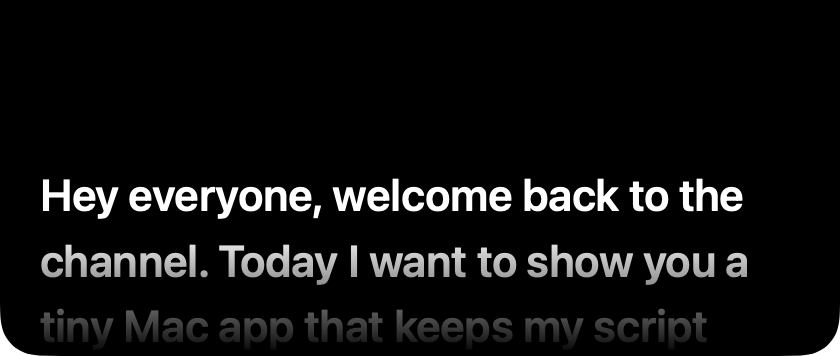
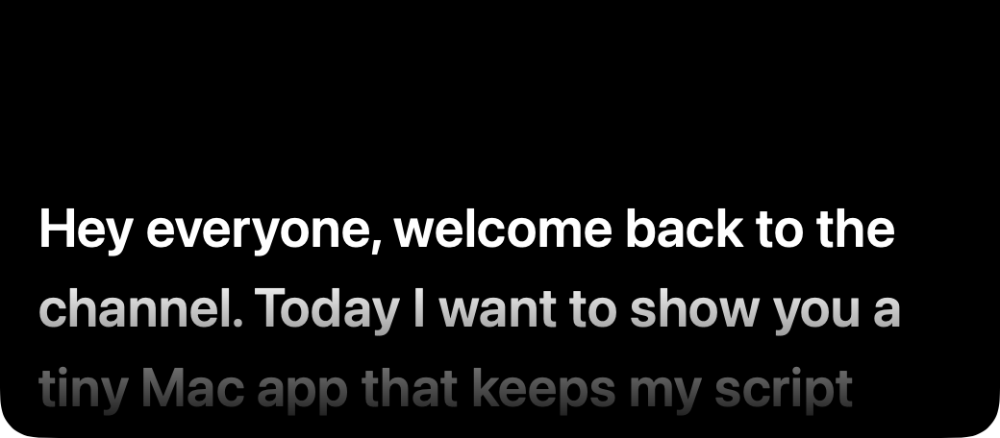

# McTelep

A teleprompter that lives in your MacBook's notch. Your script scrolls in a black panel that grows out of the notch, right below the camera, so you look at the lens while you read.

Built for recording videos (Loom, YouTube, talking head). The prompter is hidden from screen sharing and screen recording.



The black area at the top sits over the notch. The current line is brightest, about a third of the way down, and the text fades out above and below it.

<details>
<summary>Large size</summary>



</details>

## Requirements

- macOS 14 or later
- Xcode command-line tools (Swift 5.9+)

## Build and run

```sh
make run     # build, bundle build/McTelep.app, and launch
make build   # build the .app only
make clean   # remove build output
```

McTelep is a menu-bar app: it has no Dock icon. Look for the ≡ icon in the menu bar.

## Usage

1. Click the menu-bar icon → **Edit Script…** and paste your script. It saves automatically.
2. Press `⌃⌥Space` to start. A 3-2-1 countdown runs, then the text scrolls.
3. Read the line about a third of the way down the panel: that's where the text is brightest.

### Keyboard shortcuts

These work from any app, so you can control the prompter while Loom or OBS has focus.

| Shortcut  | Action              |
| --------- | ------------------- |
| `⌃⌥Space` | Play / pause        |
| `⌃⌥↑`     | Faster (+10 wpm)    |
| `⌃⌥↓`     | Slower (−10 wpm)    |
| `⌃⌥R`     | Back to the start   |
| `⌃⌥H`     | Show / hide panel   |

### Mouse

- **Click** the panel to play or pause.
- **Scroll** on the panel to move the text by hand (this pauses auto-scroll).

### Menu-bar options

- **Speed**: in words per minute, 80–220 (default 140)
- **Size**: Small, Medium or Large panel and text
- **3-2-1 Countdown**: on or off
- **Show / Hide Prompter**, **Restart**, **Quit**

The script, speed, size and countdown setting are kept between launches.

## Displays

The prompter appears on the built-in display (the one with the notch and camera). On a Mac without a notch, or with only an external display, it shows at the top center of the main screen, just below the menu bar.

## Taking screenshots of the prompter

The panel is hidden from screen capture, so normal screenshots won't show it. To capture it, launch the app with hiding turned off:

```sh
MCTELEP_ALLOW_CAPTURE=1 build/McTelep.app/Contents/MacOS/McTelep
```

## Known limitations

- Hiding from screen capture uses `NSWindow.sharingType = .none`. Some newer capture paths (ScreenCaptureKit) may still record the window, so test with your recorder before a real take.
- When the script reaches the end, play does nothing until you press `⌃⌥R`.
- Shortcuts are fixed. If another app already uses one, that shortcut won't work.
- Plain text only: no formatting or cue markers.
- Unsigned (ad hoc signed) build for personal use.

## Project layout

```
Sources/McTelep/
  main.swift                app entry point
  AppDelegate.swift         menu-bar menu, panel placement, shortcuts
  PrompterPanel.swift       the floating notch window and mouse handling
  PrompterView.swift        SwiftUI drawing of the panel and text
  PrompterController.swift  play/pause, countdown, scroll speed
  HotKeys.swift             global shortcuts (Carbon)
  EditorWindow.swift        script editor window
  Settings.swift            saved settings (UserDefaults)
Support/Info.plist          app bundle settings (menu-bar only)
Makefile                    build and run
```
